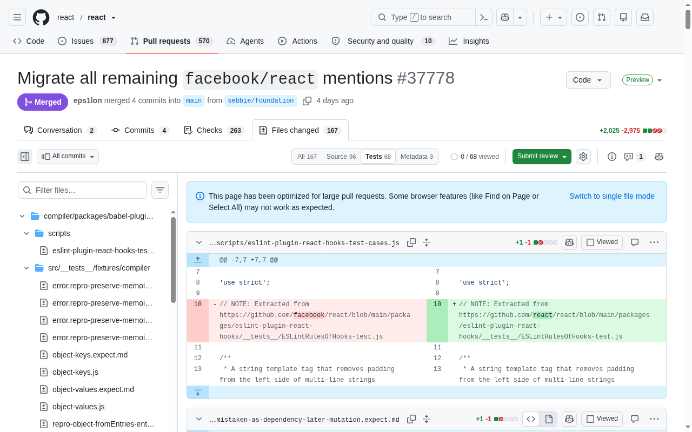

<h1 align="center">Sift for GitHub</h1>

<b>Review big GitHub pull requests one kind of file at a time.</b> 
Tabs for Source, Tests, Docs, Infra, Manifest and Artifacts on every pull request, 
and big PRs that load fully in seconds.

<a href="https://chromewebstore.google.com/detail/jkdaphdpihedahfccnneeloflldfejnn"><b>Add to Chrome</b></a> · <a href="#install">Install</a> · <a href="#benchmarks">Benchmarks</a>

## Why

In a 150-file pull request, the dozen files that need real review hide among lock files,
snapshots, generated code, docs and CI config. And GitHub loads diffs one request at a time,
so on a big PR you wait half a minute or more, or scroll and wait, before you can even look.

Sift for GitHub fixes both, right on GitHub's Files changed page.

## What you get

- **One kind of file at a time.** Tabs for **Source, Tests, Docs, Infra, Manifest and
  Artifacts**, each with a file count. The file tree follows the tab you're on.
- **Smart defaults.** Lock files, readmes and changelogs go to Manifest; Dockerfiles,
  Terraform, CDK, serverless and CI configs to Infra; `dist/`, minified and generated code to
  Artifacts; test files (not test config) to Tests. Source is whatever's left: the code.
- **Big PRs, loaded.** The tab you open loads first, the rest of the PR right after, several
  requests at a time. A 167-file PR is fully loaded in about **6.5 s** instead of **30-45 s**;
  an 898-file one in **22 s**, where GitHub alone had 22 files after 90 s.
- **Instant tab switches.** Once loaded, switching tabs makes **no requests**.
- **Your tabs, your rules.** Rename, reorder or add tabs with
  [gitignore-style patterns](#make-your-own-tabs) you already know. Pick the tab PRs open on;
  your choice on each PR is remembered across refreshes.
- **Works on both Files changed pages,** the new one and the classic one.
- **Private.** No account, no tracking, no servers. It only talks to GitHub, for the PR you're
  viewing. [Privacy policy](store/PRIVACY.md).

## Install

**[Add Sift to Chrome from the Chrome Web Store](https://chromewebstore.google.com/detail/jkdaphdpihedahfccnneeloflldfejnn)**.
Updates install automatically.

Or install a release by hand:

1. Download the latest zip from [Releases](../../releases/latest) and unzip it.
2. Open `chrome://extensions` and turn on **Developer mode**.
3. Click **Load unpacked** and pick the unzipped folder.

Then open any pull request's **Files changed** page.

## Make your own tabs

Open the extension's options page to rename, reorder or add tabs, pick the tab PRs open on,
and choose whether tabs with no files in the open PR are hidden (on by default).

One pattern per line, in [gitignore syntax](https://git-scm.com/docs/gitignore#_pattern_format)
(matched case-insensitively). Rules apply top to bottom and a later rule overrides an earlier
one. A tab whose first line is a `!` starts from every file, otherwise from none.

- `*.md` matches a file or folder name at any depth; `package*.json` any name like it.
- `docs/*.md` or `/build` (a slash at the start or middle) is relative to the repo root.
- `test/` (trailing slash) matches folders: every file under any `test` folder.
- `*` is anything but `/`, `?` one character, `[abc]` one of a set, `**` any folders
  (`a/**/b.js`). `#` starts a comment; `\!` and `\#` escape a leading `!` or `#`.
- `!*.md` excludes files matching a pattern; a later `docs/*.md` brings some back.
- `!Manifest` excludes files the tab labelled Manifest would hold: Manifest's rules are run on
  the file, recursively expanding its own `!Tab` lines. References back to a tab already being
  checked are skipped, so tabs can exclude each other (`!Infra` in Tests, `!Tests` in Infra):
  a file both would hold then shows in neither (and lands in Source, which excludes both).

## Experiments

The loading speed-ups are experiments, all on by default; turn any off in the options page.

- **Load the open tab first.** Asks GitHub's own diff loader for every file of the open tab in
  large batches, instead of GitHub's one small request at a time through the whole PR.
- **Load the rest in the background.** Then fetches every other file, so switching tabs is
  instant. Off: only the open tab loads (GitHub's large-PR list is used for that, so Find on
  Page then only sees diffs near the screen).
- **Parallel diff loading.** Splits large requests into small ones that run 6 at a time.

The classic Files changed page already loads every diff in two requests, so it's left as is.
GitHub's own file tree and "viewed" counter show the open tab's files. The page scripts reach
into GitHub's React internals; if GitHub changes them, they step aside and tabs fall back to
hiding files with CSS. How it all works: [ARCHITECTURE.md](ARCHITECTURE.md).

## Benchmarks

Measured 2026-10-17 on [react/react#37778](https://github.com/react/react/pull/37778/changes)
(167 files), headless Chrome, opening on the Source tab (96 files), 2 runs each. Times are from
navigation start; GitHub itself takes about 4-5.7 s before its first diff request. "Before" is
v0.3.0 (diffs loaded on demand as they neared the screen).

**New page**

| | Before | Defaults | Background load off |
|---|---|---|---|
| All Source diffs loaded | only when scrolled to | 6.7-8.1 s | 5.6-6.5 s |
| Whole PR loaded | never | 8.1-8.8 s | never (by design) |
| Diff requests during load | 2 | 11-12 | 5-7 |
| Diff requests on 5 tab switches afterwards | 6-8 | **0** | 9 (other tabs load when opened) |

Without the extension GitHub needs 42 sequential requests, 30-45 s, for the whole PR.

**Larger PRs** (new page, opening on Source, logged in, 2 runs). "GitHub alone" is this build
with every experiment off: GitHub switches these three to its large-PR list by itself, so
without the extension diffs only load as you scroll to them. v0.4.0 loaded one batch at a time;
now batches are split into parallel requests (Parallel diff loading).

| PR | Files (Source) | GitHub alone after 90 s | Source loaded, v0.4.0 → now | Whole PR loaded, v0.4.0 → now |
|---|---|---|---|---|
| [react/react#37778](https://github.com/react/react/pull/37778/changes) | 167 (96) | (not virtualized) | 6.4-8.4 s → **5.2-6.1 s** | 6.8-8.4 s → **6.5-6.6 s** |
| [microsoft/vscode#151512](https://github.com/microsoft/vscode/pull/151512/changes) | 898 (617) | 22 files | 30-35 s → **19-20 s** | 40-48 s → **22-23 s** |
| [kubernetes/kubernetes#102196](https://github.com/kubernetes/kubernetes/pull/102196/changes) | 336 (286) | 8 files | 11 s → **7 s** | 12 s → **7.4-8.2 s** |
| [vercel/next.js#78559](https://github.com/vercel/next.js/pull/78559/changes) | 770 (60) | 9 files | 11-12 s → 11-12 s | 44-48 s → **19 s** |

Tab switches after loading made **0 requests** on every PR (GitHub alone: 3-6 per 5 switches).

**Classic page** (logged out, cold browser cache)

| | Before | Now |
|---|---|---|
| All Source diffs loaded | only when scrolled to | 1.9-7.4 s (with every other diff) |
| Diff requests | 7 | 2 |
| Diff requests on 5 tab switches afterwards | 19 | **0** |

**Opening on All** (Parallel diff loading, measured 2026-10-16): every diff loaded in 11-15 s
instead of 35-47 s, about 5 requests in flight instead of 1.

Not measured yet: main-thread and memory cost, and arriving at a PR from elsewhere on GitHub
without a reload.

## Build and release

- The options page is React with Cloudflare's [Kumo](https://kumo-ui.com) components, source in
  `options/`, bundled into `build/`. Run `npm ci && npm run build` once before **Load unpacked**
  from the repo (`npm run watch` rebuilds on change). The content scripts aren't built.
- `scripts/build.sh` builds the options page, checks the scripts and the manifest and writes
  `dist/sift-for-github-<version>.zip`. CI runs it on every push and pull request and keeps
  the zip as a build artifact.
- To release, bump `version` in `manifest.json`, commit, then tag and push it:
  `git tag v0.7.0 && git push origin v0.7.0`. CI creates a GitHub release with the zip and
  uploads and publishes it to the [Chrome Web Store listing](https://chromewebstore.google.com/detail/jkdaphdpihedahfccnneeloflldfejnn).
- `store/` has the store listing, privacy policy, screenshots and promo images
  (`store/render.sh` redraws the icons and promo tiles). See [store/README.md](store/README.md).
